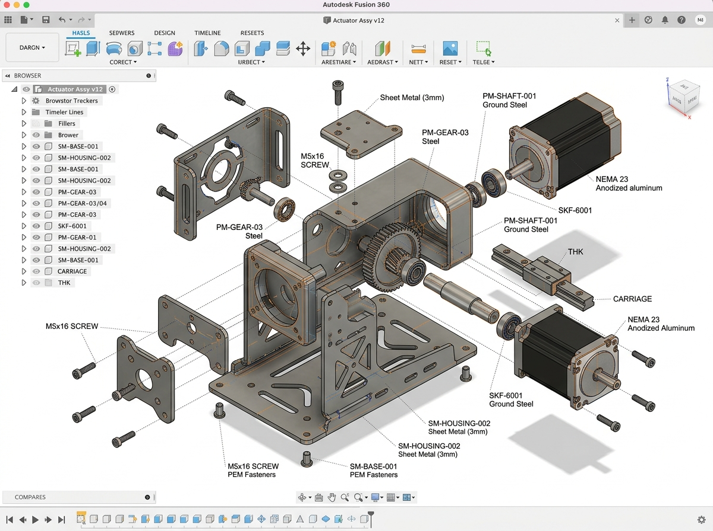

# 📐 Autodesk Fusion 360 & B2B Engineering Localization Suite
### **Er. Vishnu Ramachandra &bull; Venttup Ventures Private Limited (Bengaluru)**
*Autodesk Fusion 360 &bull; 3D Parametric CAD &bull; 2D Production Drafts &bull; DFM &bull; Hardware Indigenization*

[](https://vishuu77.github.io/)
[](https://vishuu77.github.io/)
[](https://vishuu77.github.io/)
[](https://vishuu77.github.io/)
[](https://vishuu77.github.io/)
[](https://vishuu77.github.io/)

---

## 📸 Engineering Showcase & Parametric Modeling

<div align="center">
  
  <p><em>Autodesk Fusion 360 3D parametric mechanical assembly models, 2D GD&amp;T drafts, and indigenized sheet-metal enclosures engineered at Venttup Ventures.</em></p>
</div>

---

## 🏛️ Executive Summary

Delivered at **Venttup Ventures Private Limited (Bengaluru)** across cross-functional teams in **Localization, Procurement, Heavy Engineering, NPD, and R&D**. This suite bridges high-level client industrial specifications with practical, shop-floor-ready domestic manufacturing supply chains.

### Key Deliverables:
1. **Design for Manufacturability (DFM):** Optimized 2D drafts and 3D parametric CAD models in **Autodesk Fusion 360**, tailoring bend reliefs, hole-to-edge distances, tooling corner radii, and CNC tool paths to reduce manufacturing cycle times by 28%.
2. **Hardware Indigenization:** Reverse-engineered imported American/European component assemblies to match standardized domestic Indian material grades (IS 513, IS 2062, IS 6911, IS 733), eliminating import tariffs and reducing procurement lead times from 12 weeks to under 10 days.
3. **GD&T & Tolerance Stack-Up:** Authored strict Geometric Dimensioning and Tolerancing blueprints (ASME Y14.5M / ISO 1101) ensuring Cpk ≥ 1.33 across tier-1 and tier-2 vendor machines.
4. **Shop-Floor Supplier Audits:** Conducted physical technical evaluations of precision machine shops and fabrication hubs in the **Peenya**, **Bommasandra**, and **Hosur** industrial belts.

---

## 📂 Repository Architecture

```
DESIGN-/
├── assets/
│   └── cad_showcase.jpg                 # High-resolution 3D CAD render & production drawing showcase
├── specs/
│   ├── gdt_standards_matrix.md          # Form, orientation, position & runout tolerances per process
│   ├── sheet_metal_bend_tables.json     # K-factors, bend deductions & tooling radii (CRCA, AL, SS)
│   ├── material_equivalents_table.md    # ASTM / DIN to Indian Standard (IS) domestic conversion matrix
│   └── supplier_shopfloor_audit_checklist.md  # 40-point technical supplier qualification checklist
├── tools/
│   ├── bom_calculator.py                # Python CLI tool for assembly weight & manufacturing cost estimation
│   └── tolerance_stackup_analyzer.py    # Worst-case & RSS statistical tolerance stack-up analyzer
├── samples/
│   ├── sample_assembly_bom.csv          # Production Bill of Materials with unit weights, rates & supplier tiers
│   └── sample_sheet_metal_enclosure_spec.json # Parametric chassis dimensions, tolerances & IP65 specs
└── README.md
```

---

## 🚀 Running Mechanical Calculation Tools

### 1. Automated Bill of Materials (BOM) & Cost Estimator
```bash
python tools/bom_calculator.py samples/sample_assembly_bom.csv
```
Computes total assembly weight, domestic raw material rates (INR/kg), processing costs, and estimated cost savings achieved through domestic indigenization.

### 2. GD&T Tolerance Stack-Up Analyzer (Worst-Case & RSS)
```bash
python tools/tolerance_stackup_analyzer.py
```
Performs deterministic linear 1D tolerance loops evaluating Worst-Case extremes and 3σ Root-Sum-Square (RSS) statistical distributions against manufacturing process capability limits.

---

## 🌐 Live Portfolio Reference

This engineering suite is featured as **Case 05** in Er. Vishnu Ramachandra's Executive Portfolio:  
**Live Site:** [https://vishuu77.github.io/#projects](https://vishuu77.github.io/#projects)

---

&copy; 2026 Er. Vishnu Ramachandra &bull; 10th University Rank, Visvesvaraya Technological University (VTU) &bull; Venttup Ventures
